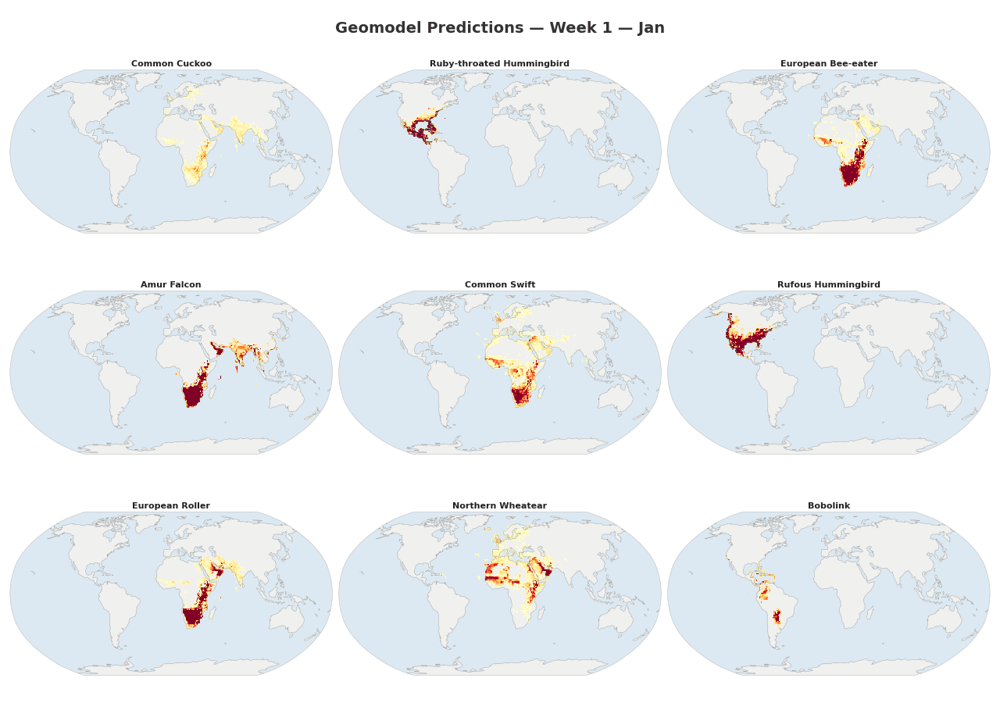

<p align="center">
  
</p>

<h1 align="center">BirdNET Geomodel</h1>

<p align="center">
  <a href="LICENSE"></a>
  <a href="LICENSE-MODELS.md"></a>
  <a href="https://www.python.org/"></a>
  <a href="https://pytorch.org/"></a>
  <a href="https://birdnet-team.github.io/geomodel/"></a>
  <a href="https://github.com/birdnet-team/geomodel/releases"></a>
  
</p>

<p align="center">
  Spatiotemporal species occurrence prediction for post-filtering BirdNET acoustic detections.<br>
  Predicts which species are likely to occur at a given location and week of the year.
</p>

<p align="center">
  
</p>

<p align="center">
  <a href="https://github.com/birdnet-team/geomodel/releases/latest"><b>Download</b></a> · <a href="https://birdnet-team.github.io/geomodel/"><b>Documentation</b></a> · <a href="CONTRIBUTING.md"><b>Contributing</b></a> · <a href="LICENSE"><b>License</b></a>
</p>

## What it does

The geomodel answers one question: which species can be expected at this place in
this week of the year? It takes latitude, longitude and week (1-48, four per month)
and returns a score per species. BirdNET apps use it to filter and rank what the
audio model detects: a detection of a species that does not occur there scores low
and is hidden or flagged.

The score follows how often a species is encountered. Common species score high,
scarce ones low, and the course of the score over the year follows migration. A
score of 0.1 corresponds to a species reported on about 0.3 % of checklists in the
area. Humans always pass (the apps use the class to detect speech), and domestic
animals sit in the middle range everywhere.

Version 4 covers 16,960 species of the BirdNET taxonomy (birds, mammals, amphibians,
insects, reptiles, fish and a few others), each with a BirdNET id.

## Install

```bash
git clone https://github.com/birdnet-team/geomodel.git
cd geomodel
python3 -m venv .venv && source .venv/bin/activate
pip install -r requirements.txt
```

## Use a released model

Release files are on the [releases page](https://github.com/birdnet-team/geomodel/releases):
a PyTorch checkpoint with its label file, and ONNX, TFLite and TorchScript exports.

```bash
python predict.py BirdNET+_Geomodel_V4.0_Global_17K.pt --lat 50.83 --lon 12.92 --week 22
python predict.py BirdNET+_Geomodel_V4.0_Global_17K.pt --lat 50.83 --lon 12.92 --week -1   # whole year
```

The exports take one float32 tensor `[batch, 3]` (latitude, longitude, week) and
return `[batch, n_species]` scores in label order. The INT8 ONNX file (weights stored
as int8, computed in float32) is the one the apps ship; its scores are within about
0.2 of the FP32 model, usually much closer.

## How the model is built

Training data come from [GBIF](https://www.gbif.org) occurrence records, habitat
layers from [Google Earth Engine](https://earthengine.google.com), and an independent
benchmark from [eBird](https://ebird.org) checklist frequencies.

```
GBIF download ─► 1 gbif_map ─► 3 gbif_targets ─► 5 dataset ─► train_teacher.py ─► distill.py ─► package.py ─► convert.py
                                     ▲                ▲            ▲ habitat            ▲ coordinates + week only
BirdNET taxonomy ─► 2 taxonomy ──────┘                │            │
Earth Engine ─────► 4 earthengine (habitat, population) ───────────┘
eBird frequencies ► 6 ebird ─► evaluation/ (benchmark, GeoScore v2)
```

1. **Records** (`pipeline/gbif_map.py`): one pass over the GBIF download keeps place,
   date, species, dataset and a hash of the observer for every record.
2. **Species** (`pipeline/taxonomy.py`): every taxonomy species is matched to the GBIF
   key its records are filed under. Species without a key have no data and are not
   in the model.
3. **Encounter rates** (`pipeline/gbif_targets.py`): per H3 cell (~250 km²) and week,
   the share of observer-days that recorded the species. Recent years weigh more.
4. **Habitat** (`pipeline/earthengine.py`): climate, land cover, elevation, surface
   water and population per cell, as area means.
5. **Training file** (`pipeline/dataset.py`): rates, effort and habitat in one file,
   split into spatially separate blocks.
6. **Benchmark** (`pipeline/ebird.py`): eBird frequencies for evaluation only. eBird
   data cannot be redistributed; to build the benchmark you need your own eBird API
   access. The file format is described in the module.

The **teacher** (`train_teacher.py`) learns encounter rates from coordinates, week and
habitat, which lets it carry what it learns from well-observed places to similar,
poorly observed ones. The **student** (`distill.py`) is the released model: it only
knows coordinates and week and learns the teacher's predictions everywhere on land,
limited to a few hundred kilometers around each species' records. `package.py` adds
the score curve and the rules for humans and domestic animals; `convert.py` exports.

The full set of commands, the file formats and the reasoning behind each step are in
the [documentation](https://birdnet-team.github.io/geomodel/).

## Evaluate

```bash
python -m evaluation.benchmark   CHECKPOINT data/benchmark/bench_20k --taxonomy taxonomy.csv  # eBird benchmark, GeoScore v2
python -m evaluation.seasonality CHECKPOINT data/benchmark/bench_20k --taxonomy taxonomy.csv  # migrants passed outside their season
python -m evaluation.groups      CHECKPOINT data/benchmark/bench_20k --taxonomy taxonomy.csv  # how taxon groups share the top of the lists
python -m evaluation.status_trends score CHECKPOINT data/st_2023_0p5.npz --taxonomy taxonomy.csv  # eBird Status & Trends maps
python -m evaluation.filter_study CHECKPOINT geofilter_pairs.parquet --taxonomy taxonomy.csv  # effect on app detections
python -m evaluation.range_maps  CHECKPOINT maps/ --species "Hirundo rustica" --taxonomy taxonomy.csv  # weekly range maps (GIF)
python -m evaluation.held_out_years test_y23.npz train_y22.npz --model y22=teacher_y22.pt        # later years vs earlier ones
python -m pytest tests                                                                        # unit tests
```

The benchmark, Status & Trends maps and app recordings are not distributed with the
repository; the [documentation](https://birdnet-team.github.io/geomodel/) describes
their formats.

## Repository

```
pipeline/        data preparation, stages 1-6
model/           network (model.py), loss (loss.py), checkpoints and score curve (io.py)
training/        training file loader, ocean rule
train_teacher.py teacher: coordinates + week + habitat
distill.py       student: coordinates + week
package.py       release checkpoint (labels, score curve, floors, caps)
convert.py       ONNX / TFLite / TorchScript exports
predict.py       species list for a place and week
evaluation/      benchmark, seasonality, Status & Trends, app filter study, range maps
data/            small curated inputs (humans and domestic animals)
docs/            documentation and the web demo
scripts/         demo animation (demo_gif.py)
tests/           unit tests
paper/           LaTeX source of the V3 paper
```

## Web demo

`docs/demo/` runs the FP16 ONNX model in the browser with
[ONNX Runtime Web](https://onnxruntime.ai/docs/tutorials/web/): range maps, species
richness, species lists and weekly bar charts for any place. Start it with
`pip install -r requirements-docs.txt && mkdocs serve` and open
<http://localhost:8000/demo/>.

## Citation

```bibtex
@misc{birdnet-geomodel,
  title={Spatiotemporal species occurrence prediction for post-filtering BirdNET acoustic detections},
  author={Kahl, Stefan and Mauermann, Max and Lasseck, Mario and Wood, Connor and Klinck, Holger},
  year={2026},
  url={https://github.com/birdnet-team/geomodel}
}
```

## License

The source code is licensed under the [MIT License](LICENSE).

Model artifacts—including checkpoints, converted models, and labels—are licensed under the [Apache License 2.0](LICENSE-MODELS.md).

## Acceptable Use

BirdNET is built to support biodiversity research and conservation. See the [BirdNET Acceptable Use Policy](ACCEPTABLE_USE.md) for responsible-use guidance, uses we consider unacceptable, and branding guidance. The policy is guidance and does not add conditions to the Apache 2.0 model license.

## Funding

Our work in the Cornell K. Lisa Yang Center for Conservation Bioacoustics is made possible by the generosity of K. Lisa Yang to advance innovative conservation technologies to inspire and inform the conservation of wildlife and habitats.

The development of BirdNET is supported by the German Federal Ministry of Research, Technology and Space (FKZ 01|S22072), the German Federal Ministry for the Environment, Climate Action, Nature Conservation and Nuclear Safety (FKZ 67KI31040E), the German Federal Ministry of Economic Affairs and Energy (FKZ 16KN095550), the Deutsche Bundesstiftung Umwelt (project 39263/01) and the European Social Fund.

## Partners

BirdNET is a joint effort of partners from academia and industry.
Without these partnerships, this project would not have been possible.
Thank you!


