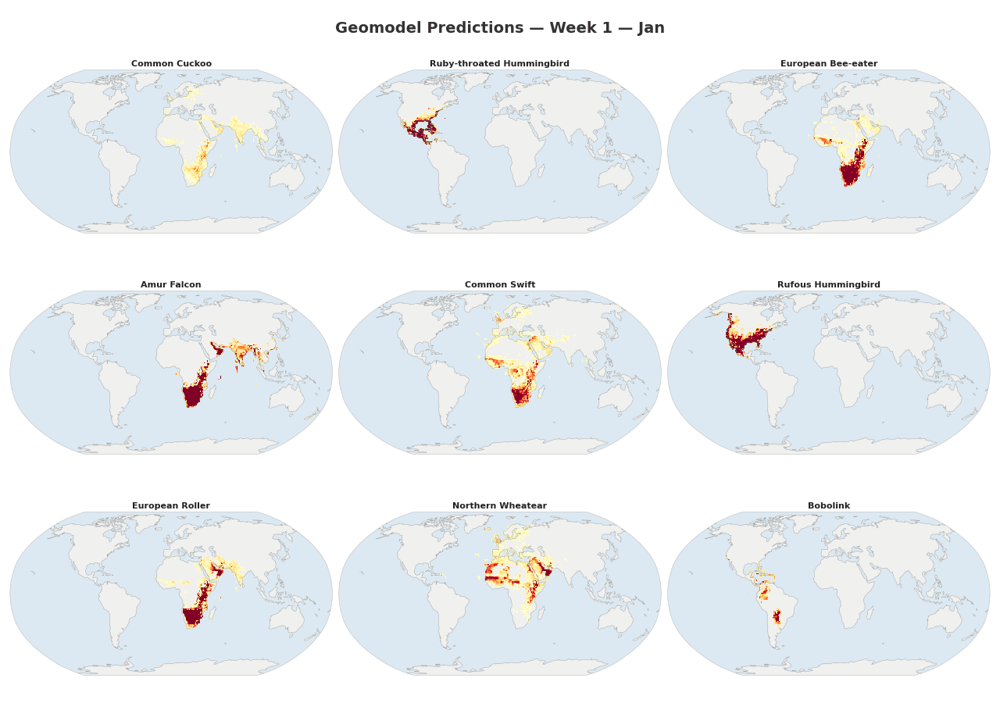
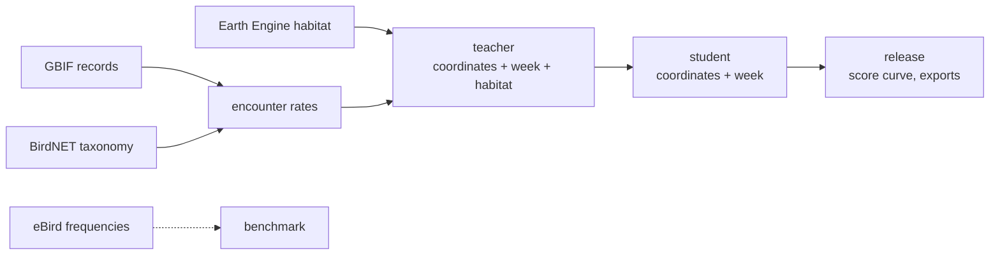

  

# BirdNET Geomodel

The geomodel predicts which species can be expected at a place in a given week of
the year. It takes latitude, longitude and week and returns a score for each of
about seventeen thousand species of the BirdNET taxonomy: birds, mammals,
amphibians, insects, reptiles and fish. BirdNET apps use it to filter and rank what
the audio model detects. A detection of a species that is not expected there scores
low and is hidden or flagged. A detection of a species that is common there passes.

  

## What the score means

The score follows how often a species is encountered at a place and time. Common
species score high, scarce ones low and rare visitors far below the line. Over the
year, the score follows migration. A score of 0.1 corresponds to a species reported
on about 0.3 % of checklists in the area. Humans always pass (the apps use the class
to detect speech), and domestic animals sit in the middle range everywhere. See
[Scores](model/scores.md).

## What it is not

The geomodel is a filter for audio detections, built for people who do not know
which species to expect where they record. It is not a species distribution model
for research or conservation planning. Its ranges are generous in places with few
records, because wrongly hiding a true detection costs more than showing an
unlikely one. If you know your study area and its species, a curated species list
will serve you better.

## Why a model and not a lookup table

Querying eBird or iNaturalist directly would mean shipping hundreds of megabytes of
occurrence data and spatial indices. The model fits in under 10 MB (the INT8 ONNX
file the apps ship) and runs on the device. It also makes reasonable predictions
where nobody has recorded anything yet, because it learns how species relate to
habitat and season instead of memorizing records.

## How it is built

1. GBIF occurrence records are turned into encounter rates per place and week:
   the share of observer-days that recorded each species ([Data pipeline](pipeline/overview.md)).
2. A teacher network learns those rates from coordinates, week and the habitat
   of the place, so it can carry what it learns to similar places with few records.
3. A student network, the released model, learns the teacher's predictions
   everywhere on land from coordinates and week alone ([Training](model/training.md)).
4. The release adds the score curve and the rules for humans and domestic animals,
   and is exported to ONNX, TFLite and TorchScript ([Export](model/export.md)).
5. Every model is checked against eBird checklist frequencies, eBird Status &
   Trends maps and real app detections ([Evaluation](evaluation/benchmark.md)).

## Links

- [Installation](getting-started/installation.md) and [Quick start](getting-started/quickstart.md)
- [Web demo](demo/index.md): range maps and species lists in the browser
- [GitHub repository](https://github.com/birdnet-team/geomodel) and [releases](https://github.com/birdnet-team/geomodel/releases)

## License

Code: [MIT License](https://github.com/birdnet-team/geomodel/blob/main/LICENSE).
Models (checkpoints, exports, labels): [Apache License 2.0](https://github.com/birdnet-team/geomodel/blob/main/LICENSE-MODELS.md).
See also the [BirdNET Acceptable Use Policy](community/acceptable-use.md); it is guidance and adds no
conditions to the model license.
