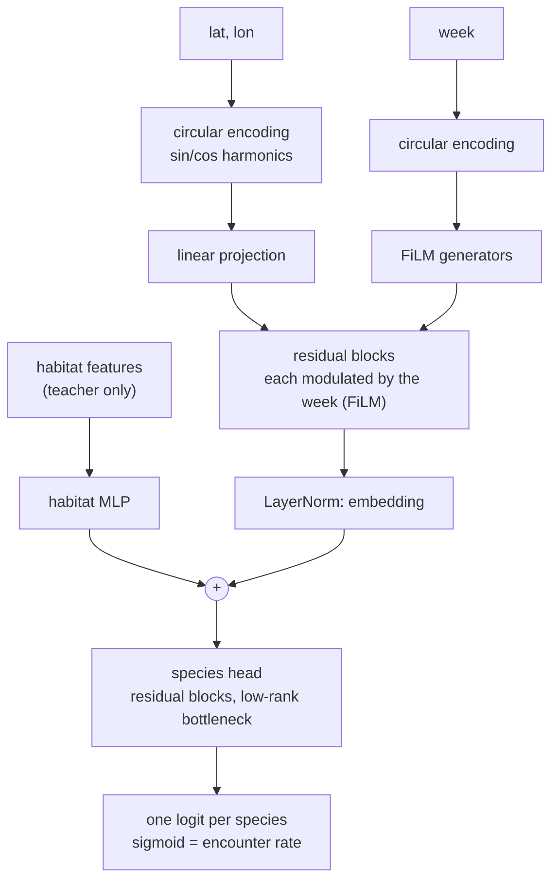

# Architecture

The released model takes three numbers, latitude, longitude and week, and returns
one value per species. Everything else (encoding, habitat, the score curve) happens
inside the network or during training. Two networks share the same building blocks:

- the **teacher** sees coordinates, week and the habitat of the place;
- the **student** sees coordinates and week only. It is the released model.

## Circular encoding

A network does not know that longitude -180° and 180° are the same place, or that
week 48 is next to week 1. Each value is therefore mapped to sine and cosine pairs
at several frequencies (Tancik et al., 2020):

$$
\text{enc}(\theta) = [\sin\theta, \cos\theta, \sin 2\theta, \cos 2\theta, \ldots, \sin n\theta, \cos n\theta]
$$

Latitude and longitude are converted to radians and encoded with `coord_harmonics`
frequencies each; the week is mapped to $[0, 2\pi)$ over 48 weeks and encoded with
`week_harmonics` frequencies. The conversion to radians is written so that it stays
exact when an export stores constants as float16 (otherwise the highest longitude
frequency would be off by enough to move scores by about 0.05).

## Encoder

The encoded coordinates are projected to the embedding width and passed through
residual blocks (LayerNorm, GELU, Linear, twice, with a skip connection). After each
block the week sets a scale and shift per channel (FiLM; Perez et al., 2018):
$x' = (1 + \tanh g) \cdot \text{block}(x) + \beta$, with $g, \beta$ produced from the
week encoding by a small MLP per block. The tanh keeps the scale between 0 and 2,
which also keeps float16 exports from overflowing. The FiLM output layers start at
zero, so at initialization the week changes nothing and the network learns how much
it matters.
LayerNorm uses $\varepsilon = 10^{-4}$, which float16 can represent.

## Species head

Residual blocks followed by a low-rank output: Linear(width → bottleneck), GELU,
Linear(bottleneck → species). With seventeen thousand species the output layer is
by far the largest part of the network, so the bottleneck width is the main knob for
the file size.

The network's sigmoid output is an **encounter rate**. Release checkpoints turn it
into the app score inside the exported graph (see [Scores](scores.md)).

## Teacher: habitat input

The teacher adds a three-layer MLP that maps the habitat features of the place
(climate, land cover, elevation, water; [Habitat](../pipeline/earthengine.md)) to a
vector of the embedding width, which is added to the encoder output before the
species head. Habitat lets the teacher predict a species in a well-matching but
little-visited valley because it has seen it in similar valleys elsewhere.

## Optional heads (ablations)

`model/model.py` keeps two heads from version 3 for comparisons:

- an **environment head** that predicts the habitat features from the embedding,
  used as an auxiliary task (`distill.py --env-aux`);
- a **habitat-species head** with a learned gate between a direct and a
  habitat-based species prediction (`distill.py --habitat-head`).

The release recipe uses neither: habitat reaches the student through the teacher.

## Size

`create_model(model_scale=...)` scales all widths linearly from scale 1.0 (width
512, four encoder blocks, two species-head blocks, bottleneck 128); block counts are
rounded. Two overrides fit a size budget: `species_bottleneck` (output bottleneck)
and `film_dim` (width of the FiLM generators, which need far less than the full
width: the week encoding has only a few dozen values).

The V4 release student:

| setting | value |
|---|---|
| `model_scale` | 1.1 (width 576, 4 encoder blocks) |
| `coord_harmonics` | 16 |
| `week_harmonics` | 8 |
| `film_dim` | 64 |
| `species_bottleneck` | 288 |
| parameters | 9.4 million in the exported graph (9.7 million with the unused habitat-prediction head kept in the checkpoint) |
| ONNX INT8 file | just under 10 MB |

## References

> Perez, E., Strub, F., de Vries, H., Dumoulin, V., & Courville, A. (2018). FiLM: Visual Reasoning with a General Conditioning Layer. *AAAI*, 3942-3951.

> Tancik, M., Srinivasan, P. P., Mildenhall, B., Fridovich-Keil, S., Raber, N., Barron, J. T., & Ng, R. (2020). Fourier Features Let Networks Learn High Frequency Functions in Low Dimensional Domains. *NeurIPS*, 7537-7547.
