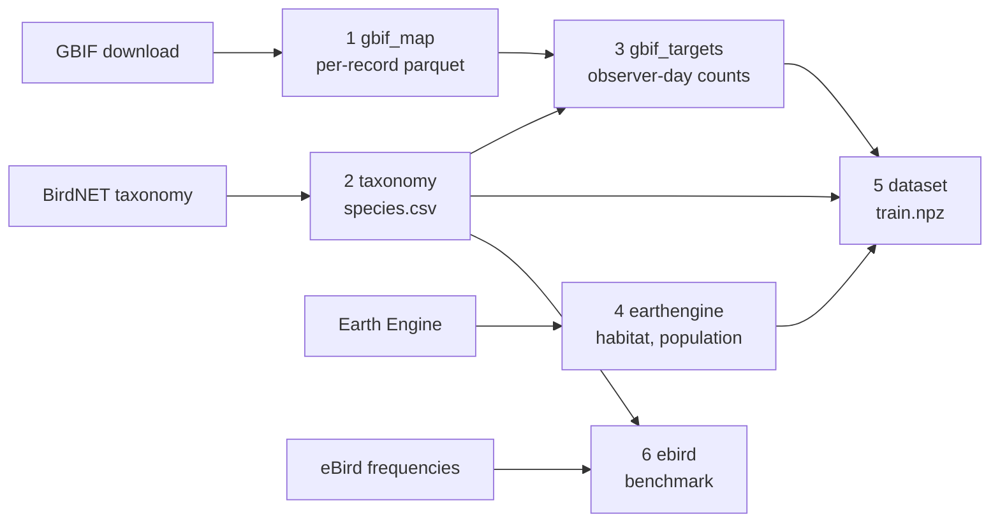

# Data pipeline

Six stages turn public data into a training file and a benchmark. Each stage is a
module in `pipeline/` and runs as `python -m pipeline.<stage>`. Every stage writes
plain files (parquet, CSV, NumPy), so any of them can be re-run or replaced on its own.



| stage | module | input | output | time |
|---|---|---|---|---|
| 1 | [`gbif_map`](gbif.md#stage-1-records) | GBIF occurrence download (DwC-A) | `part_*.parquet`, one row per record | one pass over the archive (a day for the full GBIF backbone on 8 cores) |
| 2 | [`taxonomy`](taxonomy.md) | BirdNET taxonomy JSON | `species.csv` with GBIF keys | about an hour of GBIF API lookups, cached |
| 3 | [`gbif_targets`](gbif.md#stage-3-encounter-rates) | stage 1 + 2 | `species_res5.parquet`, `effort_res5.parquet` | a few hours (DuckDB) |
| 4 | [`earthengine`](earthengine.md) | Earth Engine account | `habitat_res5.parquet`, `population_res5.parquet` | about an hour each |
| 5 | [`dataset`](dataset.md) | stage 2, 3, 4 | `train.npz` | under an hour |
| 6 | [`ebird`](ebird.md) | your own eBird frequency responses | `bench_*_cells.parquet`, `bench_*_freq.parquet` | minutes |

A full rebuild, with the paths used throughout the documentation:

```bash
unzip -p gbif_download.zip occurrence.txt | python -m pipeline.gbif_map data/gbif_map --workers 8
python -m pipeline.taxonomy taxonomy.json data/species.csv --cache data/gbif_keys.json
python -m pipeline.gbif_targets data/gbif_map data/species.csv data/targets --effort naturalist
python -m pipeline.earthengine cells data/ee/cells_res5.txt
python -m pipeline.earthengine habitat data/ee/cells_res5.txt data/ee/habitat_parts
python -m pipeline.earthengine collect data/ee/habitat_parts data/ee/habitat_res5.parquet
python -m pipeline.earthengine population data/ee/cells_res5.txt data/ee/population_parts
python -m pipeline.earthengine collect data/ee/population_parts data/ee/population_res5.parquet
python -m pipeline.dataset data/targets data/species.csv data/ee/habitat_res5.parquet data/train.npz
python -m pipeline.ebird data/ebird_responses data/species.csv data/benchmark/bench_20k
```

## The grid

Places are [H3](https://h3geo.org/) cells. Records are stored at resolution 6
(~36 km²) so that coarser grids are a cheap re-run; training uses resolution 5
(~250 km², about 17 km across). H3 cells have nearly equal areas everywhere, unlike
latitude-longitude boxes, and each cell has a single parent at every coarser
resolution.

## Weeks

The year has 48 weeks, four per month: days 1-7, 8-14, 15-21 and 22 to the end of
the month. eBird uses the same convention, which makes the benchmark line up with
the model without any resampling.

## What the targets mean

The training target is an **encounter rate**: of all the observer-days in a cell
and week, the share on which the species was recorded. It is what a birder would
call "how often do you see it there", and it is what the app score is built from
(see [Scores](../model/scores.md)). It is not abundance, and it is not presence:
a species recorded once in ten years in a busy cell has a tiny rate, which is the
point. The original V3 model trained on "was it ever recorded here" and therefore
scored a single vagrant record like a common breeder.
